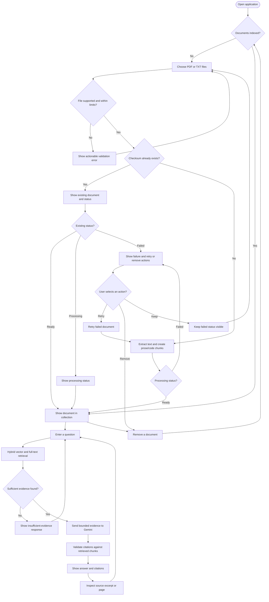
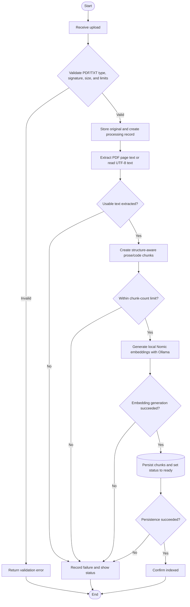
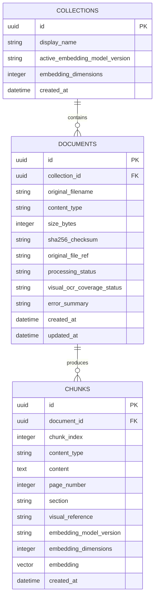
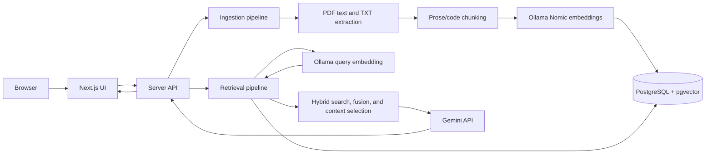
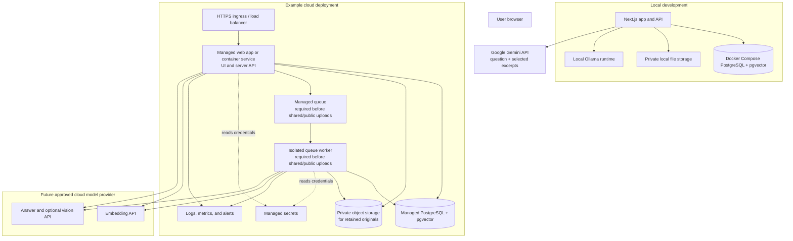
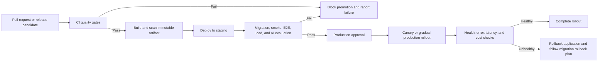

# Chat With Your Docs — Technical Implementation Plan

> This document records both design reasoning and future proposals. The
> implementation checkpoint below is the source of truth for what is currently
> implemented; production and OCR/vision sections are plans, not shipped
> capabilities.

## 1. Goal

Build a polished, full-stack application that lets a user upload a small collection of documents and ask questions answered from their contents. Answers should be grounded in retrieved passages, include source citations, and say when the available documents do not provide enough information.

The initial release prioritizes a dependable end-to-end workflow and clear engineering trade-offs over broad format support or production-scale infrastructure.

## 2. Scope

### MVP requirements

- Upload PDF and plain-text (`.txt`) documents.
- Extract text and code while preserving useful structure, split content into appropriate chunks, and create embeddings.
- Support text-based PDFs and text files as the dependable ingestion baseline.
- Store documents, chunks, and vectors for retrieval.
- Ask questions against the uploaded collection.
- Generate answers from relevant retrieved chunks and show citations linked to source documents.
- Display ingestion and query errors clearly.
- Provide a responsive, accessible interface and a useful empty/demo state.
- Include automated tests, local setup instructions, and basic operational logging.

### Future enhancements (not currently implemented)

- Preserve code indentation and line boundaries in `.txt` files and retain code-like blocks in PDFs where extraction allows.
- For supported PDFs, extract embedded images or render pages when needed to capture diagrams; use a vision-capable model to create searchable, labeled descriptions.
- Use OCR for scanned pages and image labels when feasible. Keep extracted text, OCR results, and generated visual descriptions distinct and traceable to their source page.
- Treat scanned-document OCR and complex visual interpretation as best-effort enhancements. If time or provider limits threaten the core workflow, complete and verify text-based PDF/TXT RAG first, then add visual processing without claiming full visual coverage.

### Out of scope for the first release

- Office-document formats, web crawling, and audio transcription.
- User accounts, team workspaces, document sharing, and fine-grained permissions.
- Streaming answers, conversational memory across separate questions, and agent/tool workflows.
- Large-scale ingestion, distributed processing, and multi-region deployment.

The current app does not process scanned pages or diagrams. If visual processing is added later, complex layouts, low-quality scans, and detailed diagrams may still be interpreted unreliably; label partial coverage and evaluate those cases.

## 3. Chosen implementation stack

This is the implementation stack for the assignment MVP. Keep the system small and use direct, explicit integrations rather than adding separate services or orchestration layers before they are needed.

| Area | Selected technology | How it will be used |
|---|---|---|
| Application and API | Next.js App Router with TypeScript | One application for the UI and server-side route handlers; no separate backend service for the MVP. |
| UI | React, application-specific CSS, and Lucide React icons | The current interface uses custom CSS and native controls; shadcn/Radix primitives are not currently used. |
| Request validation | Zod | Validate upload metadata, questions, IDs, and API responses at system boundaries. |
| Database | PostgreSQL with `pgvector` | Store collections, documents, typed chunks, and embeddings; run similarity search with collection/document filters. |
| Database access | Drizzle ORM, migrations, and parameterized SQL for vector search | Use typed schema and migrations for relational operations; use explicit SQL for pgvector-specific similarity queries. |
| Local infrastructure | Docker Compose | Run PostgreSQL with the pgvector extension locally; retain originals in a private, non-committed data directory so citations can link to source pages. |
| PDF processing | `pdfjs-dist` | The current pipeline extracts text and page metadata from text-based PDFs; it does not render pages. |
| OCR | Deferred; no OCR package or processing path is currently implemented | Add OCR for scanned pages only after selecting, integrating, and testing a bounded PDF rendering/OCR path. |
| Visual understanding | Deferred; no vision model is currently called | Add traceable, clearly labeled visual descriptions only after selecting and evaluating a suitable provider/model. |
| Embeddings and answer generation | Local Ollama `nomic-embed-text` for document/query embeddings; Google Gemini API via `@google/genai` for answer generation | Embeddings and retrieval stay local. The question and selected evidence excerpts are sent to Gemini; the original file and prior chat transcript are not sent. |
| Observability | Pino structured logs | Current logs include request IDs and aggregate retrieval/citation counts. OpenTelemetry traces, metrics, dashboards, and alerts remain future work. |
| Tests | Vitest unit tests and manual browser smoke checks | Playwright end-to-end automation and PostgreSQL integration-test harnesses are not currently included. |

### Model selection

The current implementation uses Ollama with `nomic-embed-text` for 768-dimensional document and query embeddings, and Gemini `gemini-3.6-flash` for answer generation. Early testing with local Qwen chat models produced incomplete answers or excessive latency on the available machine, so Gemini replaced local answer generation. The Gemini key and model are server-side configuration; Ollama is restricted to loopback. Gemini receives the current question and selected evidence excerpts, not the original file or prior chat transcript. The UI and README disclose this provider data flow and the free-tier terms. Transient Gemini 500/502/503/504 responses receive at most two retries with exponential backoff and jitter; quota (429) errors remain explicit. A prolonged provider outage can still prevent an answer.

The current implementation has not been quality-evaluated against a broad, human-reviewed set of real documents. Synthetic Gemini generation tests and local retrieval tests are useful checks, not a general quality guarantee. Measure answer support, citation correctness, retrieval recall, latency, and cost on representative, consented documents before treating the model configuration as final. OCR and diagram/image interpretation remain deferred. Any future provider change requires a separate data-terms, privacy, and cost review.

### Alternatives considered

| Concern | Chosen for this MVP | Alternative | Reason for deferring the alternative |
|---|---|---|---|
| Backend architecture | Next.js route handlers | Separate FastAPI/Express service | A separate service adds deployment and interface overhead before processing scale requires it. |
| Vector storage | PostgreSQL + pgvector | Managed dedicated vector database | One database is simpler to run and sufficient for the expected assignment-sized corpus. |
| RAG orchestration | Direct provider SDK and small application-owned functions | LangChain or LlamaIndex | The workflow is short and benefits from explicit, inspectable retrieval and citation logic. |
| OCR/visual analysis | Deferred; no OCR or vision implementation is selected | Managed document-AI platform | First verify the local text-based RAG workflow; managed document-AI adds an external data-processing dependency and cost. |
| Ingestion execution | Synchronous processing for the local MVP | Queue and background worker | Avoid queue infrastructure in the local demo; the production plan requires a durable queue and isolated worker before shared/public uploads. |

This stack is optimized for the assignment MVP, not declared universally best. Revisit these choices if evaluation shows extraction quality, throughput, cost, or operational needs are not met.

### Decisions that evolved during implementation

| Initial direction or issue | Evidence / reason | Current decision |
|---|---|---|
| Use a small local chat model for generation | Early Qwen experiments produced incomplete answers and high latency/CPU use on the available machine. | Keep embeddings and retrieval local with Ollama; use Gemini only for structured answer generation, with the outbound excerpt flow disclosed. |
| Start with vector-first retrieval | Realistic resume questions need both semantic matching and exact employer/date/skill matches. | Combine pgvector and PostgreSQL full-text candidates using reciprocal-rank fusion, then expand neighboring chunks around selected seeds. |
| Use Nomic embeddings as raw text vectors | Retrieval quality depended on matching the model's task-specific input format. | Prefix documents with `search_document:` and questions with `search_query:`; version the format and reindex rather than mixing incompatible vectors. |
| Treat a successful API key check as sufficient for generation | Gemini can return intermittent 5xx service errors even while the key is configured. | Retry transient 500/502/503/504 responses at most twice; keep quota and persistent provider failures visible, with no silent model fallback. |

## 4. User experience

The current interface is built with React, application-specific CSS, native controls, and Lucide icons; it does not use shadcn/ui. The collection, conversation, upload state, citations, and evidence preview are composed specifically for this application.

The primary screen should make the collection and conversation understandable at a glance:

1. **Collection panel:** upload documents, view processing status, see indexed documents, and remove a document.
2. **Conversation panel:** ask a question, see loading/error states, and read the answer.
3. **Evidence panel or citation list:** show source filename and page or chunk location where available, with a concise excerpt that supports the answer.
4. **Empty state:** explain how to add documents and provide a few example questions.

Design for keyboard use, visible focus, readable contrast, responsive layouts, and clear feedback for unsupported files, empty documents, and failed processing. Avoid presenting a fluent answer without its sources.
The MVP persists the visible transcript in browser local storage so it survives refreshes; a new conversation clears the saved transcript. Prior turns are not included in model context, and transcript text may contain document-derived answers, so the browser profile is local sensitive data.

### User flow

### Data flow

```mermaid
flowchart LR
    subgraph Ingestion
        File[Uploaded PDF or TXT] --> Validate[Validate type, signature, and limits]
        Validate --> StoreOriginal[(Private local original-file storage)]
        StoreOriginal --> Extract[Extract text with page metadata]
        Extract --> Chunk[Structure-aware prose/code chunking]
        Chunk --> Embed[Ollama Nomic document embeddings]
        Embed --> Persist[(Persist chunks/vectors and finalize status)]
    end
    subgraph Question answering
        Question[User question] --> QueryEmbed[Ollama Nomic query embedding]
        QueryEmbed --> Search[Filtered vector + PostgreSQL full-text search]
        Persist --> Search
        Search --> Fusion[Reciprocal-rank fusion and neighbor expansion]
        Fusion --> Context[Build bounded evidence context]
        Question --> Context
        Context --> Generate[Gemini structured answer generation]
        Generate --> ValidateCitations[Validate cited chunk IDs]
        ValidateCitations --> Response[Answer, citations, excerpts, page references]
    end
```

### Activity diagram

OCR, scanned-page handling, PDF rendering, and visual descriptions are not in
the current ingestion path; they remain future work.

### Data relationship diagram

## 5. Architecture diagram

### Deployment diagram

The interview deliverable runs the web app and PostgreSQL/pgvector locally; Ollama provides local embeddings, while Gemini generates answers from the question and selected excerpts. The original file and retrieval remain local, but those excerpts leave the machine for generation. The cloud layout below is a productionization direction, not a requirement to deploy the initial submission.

In the cloud deployment, keep the database and object storage private, expose only the HTTPS entry point, and allow outbound provider calls only from server-side app/worker components. Store credentials in the managed secret service. A private, low-volume single-user deployment may begin with synchronous ingestion; require the queue and isolated worker before enabling shared/public uploads.

## 6. Request flows

**Ingestion**

1. Validate extension, detected file type, size, page count, collection document count, and configured processing limits.
2. Check the collection checksum. Return the existing document if it is already present; offer the explicit retry operation only when that document is `failed`.
3. Store the original privately and create a `processing` document record before expensive parsing so the UI can report status and failures.
4. Extract text from text-based PDFs by page or decode UTF-8 TXT; retain PDF page boundaries and available headings.
5. Classify prose and code-like passages, then create bounded, structure-aware chunks with overlap and source metadata.
6. Generate 768-dimensional Nomic embeddings locally with Ollama, using the document-task prefix; batch requests within configured limits.
7. Persist chunks/vectors and mark the document `ready` only after successful indexing. Record failures explicitly and allow retry of a failed document.
8. Keep the original in private local storage for source evidence and remove it together with its database rows and chunks when the document is deleted.

Scanned-PDF OCR, PDF page rendering, and visual descriptions are not implemented. Add them only in a separately evaluated future phase; do not imply that the current app indexes image-only content.

**Question answering**

1. Validate the question and identify the active collection. Do not send prior conversation turns; each question is independently grounded in the collection.
2. Embed the question locally with the collection's active Nomic embedding version and dimensions; never compare vectors produced by incompatible models.
3. Retrieve candidates from both pgvector similarity search and PostgreSQL full-text search, filtered to the active collection and searchable document statuses. Fuse ranked results with reciprocal-rank fusion, then expand neighbors around selected seeds.
4. Build a bounded prompt from the question and selected evidence excerpts. The current context uses separate character budgets for regular and list questions.
5. Ask Gemini to return schema-constrained JSON grounded only in the supplied evidence; list questions use a separate structured list response.
6. Validate citation keys against chunks retrieved for that request and return the answer, citations, excerpts, and PDF page references. Abstain when evidence or valid citations are insufficient.

## 7. Data model

Use a minimal schema, with migrations:

- **documents**: ID, collection ID, original filename, content type, size, SHA-256 content checksum, private original-file reference, processing status, visual/OCR coverage status, error summary, timestamps.
- **chunks**: ID, document ID, chunk index, text, content type (`prose`, `code`, `ocr`, or `visual_description`), page/section metadata, optional visual reference, embedding model/version and dimensions, embedding vector, timestamps.
- **collections**: ID, display name, active embedding model/version, embedding dimensions, timestamps. Create one default collection for the single-user MVP; defer creating additional collections in the UI.

Create one explicit default collection for the MVP and include its ID in every list, retrieval, and deletion query. This is a data boundary, not authentication or multi-tenant isolation; do not expose shared access until authorization is implemented.

Use explicit document statuses: `processing`, `ready`, `partial`, and `failed`. The schema and UI support `partial`, but the current text-only ingestion path marks documents `ready` or `failed`; it does not yet produce partial-coverage documents. If future optional OCR/visual stages are introduced, define when partial is appropriate and explain missing coverage in the UI. Enforce a unique `(collection_id, sha256_checksum)` constraint so uploading the same file again reports the existing document instead of silently creating duplicate chunks. Allow retry only for a failed document through an explicit retry operation; do not create a duplicate record.

Record the embedding model version and dimension with indexed chunks and the active model on the collection. The current schema includes OCR/visual evidence types and metadata fields as future-ready structure, but the ingestion pipeline currently writes only prose and code chunks. A model change requires re-embedding all searchable chunks before switching the collection's active version; keep the prior version available until the migration is verified so retrieval never mixes incompatible vector spaces.

The local demo has one default collection and no owner column. Before shared cloud use, add an owner/tenant ID to each collection and enforce the authenticated ownership filter on every document, chunk, retrieval, retry, and deletion operation.

For the local demo, keep original files in a private, non-served data directory so page previews are possible. Deleting a document must remove its database row, chunks/vectors, and stored original. Keep files until user deletion for the demo; document this retention behavior. For production, move originals to private object storage and apply the proposed 30-day retention default unless an approved privacy policy requires a shorter period. At expiry, remove the original and its derived chunks/vectors together so expired content cannot remain searchable or cited.

## 8. Retrieval, prompting, and quality controls

- Use structure-aware chunking: split prose on headings/paragraphs, preserve code indentation and line boundaries, and store OCR/visual descriptions as separately typed chunks. Record size/overlap in configuration and tune with representative documents.
- The current retrieval path combines vector similarity search with PostgreSQL full-text candidates using reciprocal-rank fusion, then expands neighboring chunks around selected seeds. Evaluate recall and citation support before changing candidate counts, thresholds, or reranking.
- Apply collection/document filters before returning evidence. Set a retrieval count and prompt-context budget to keep latency and cost bounded.
- Use a grounded-answer prompt that distinguishes evidence from inference, requires citations, and instructs the model to abstain when evidence is missing.
- Treat user questions, document text, OCR output, and visual descriptions as untrusted input. Documents are evidence, not instructions; never allow embedded text to override system behavior.
- Keep the assistant read-only: do not give the model tools, shell access, filesystem access, or the ability to execute code or change application state.
- If retrieval does not meet a relevance threshold calibrated using the evaluation set, return an insufficient-evidence response instead of asking the model to guess. Do not rely on prompt instructions alone to make this decision.
- Request a constrained answer shape containing answer text and cited chunk IDs. Validate the response schema and ensure every citation refers to a chunk retrieved for that request; reject or safely abstain on malformed or fabricated references.
- Keep OCR text and model-generated visual descriptions labeled as derived evidence. Cite the source page and avoid stating uncertain visual interpretations as exact source text.
- Evaluate a small set of representative questions, including answerable, ambiguous, and unanswerable cases. Check both factual support and citation correctness.
- Show retrieved excerpts and page references so users can inspect the evidence. Treat the answer as assistance, not a guarantee of correctness.

### User-facing safety behavior

- Keep the product purpose narrow: answer questions using the active document collection. For unrelated questions or questions with insufficient evidence, clearly say the documents do not support an answer.
- Never invent a citation, page, quote, or claim that a source was checked when it was not.
- Clearly mark OCR and vision-generated descriptions as machine-derived and fallible.
- Render model output as sanitized Markdown or plain text; do not allow raw HTML or unsafe links from a document or model response to execute in the browser.
- Show actionable errors without exposing internal prompts, provider responses, filesystem locations, credentials, or document contents in error details.

## 9. API outline

Implement these as Next.js App Router route handlers and validate input/output schemas with Zod.

| Endpoint | Purpose |
|---|---|
| `POST /api/documents` | Upload, validate, parse, embed, and index one document; return the existing record for a duplicate checksum. |
| `GET /api/documents` | List documents in every status (`processing`, `ready`, `partial`, and `failed`). |
| `POST /api/documents/:id/retry` | Retry processing an existing `failed` document without creating a duplicate. |
| `DELETE /api/documents/:id` | Remove the document, its chunks/vectors, and its stored original. |
| `POST /api/questions` | Retrieve evidence and return an answer with citations. |

Return consistent error responses with a safe user-facing message and a server-side diagnostic identifier. Never return secrets, raw provider errors, or uploaded file contents in error details.

For the local demo and a private, low-volume single-user cloud deployment, upload and retry routes may process synchronously and return the final document status; the UI shows an in-progress indicator while waiting. For shared/public cloud uploads, the durable queue-based path returns `202 Accepted` with a document/job ID, then the client reads status through `GET /api/documents`. Do not implement fire-and-forget in-process work as a substitute for the durable production queue.

## 10. Security and reliability

- Enforce upload size, detected type, page count, collection document count, and request-body limits on the server; do not trust browser-supplied MIME types alone.
- Allow only PDF and plain-text files; verify file signatures/content and do not use the submitted filename as a path.
- Generate internal IDs; treat original filenames as display metadata, not filesystem paths.
- Store uploaded originals outside public/static directories; reject malformed files and avoid extracting arbitrary filesystem paths from archive-like input.
- Bound parser/OCR CPU, memory, page count, and execution time. For a public production deployment, process untrusted files in an isolated worker and add malware scanning appropriate to the threat model.
- Keep provider credentials in environment variables or a deployment secret manager. Do not expose them to client bundles or logs.
- Use parameterized database operations and validate IDs and request payloads.
- Use transactions or explicit processing states so failures do not leave documents appearing ready with missing vectors.
- If original-file storage succeeds but creating the processing record fails, remove the orphaned original and log/report any cleanup failure.
- Make deletion idempotent and ensure it removes all document-derived records and the retained local original.
- Define timeouts and handle provider rate limits and failures visibly. Avoid retry loops without limits.
- Bound concurrent processing, model input/output tokens, and per-request work; add rate and spend controls before public deployment.
- For the local demo, disclose that original files, extraction, embeddings, and retrieval stay local, while the current Gemini integration receives the question and selected evidence excerpts. Do not log full document text, prompts, or answers by default.
- Prevent cross-collection retrieval. Add authentication and authorization before exposing the app to multiple users or public uploads.
- Set retention and deletion behavior for uploaded content and embeddings before production use.

### Initial local limits

Use conservative configurable defaults and revisit them after testing on the target development machine and provider:

- Maximum 10 documents per collection.
- Maximum 10 MiB per file; maximum 1 MiB for `.txt` files.
- Maximum 50 pages per PDF.
- Maximum 2,000 characters per question.
- Bound chunk count, embedding batch size, retrieved chunks, prompt context, provider timeouts, and visual pages processed per document in configuration.

Reject an upload that exceeds a hard limit with a specific, user-facing explanation. If optional visual processing hits its configured cap, index the extracted text and mark the document `partial` with the visual coverage limitation.

The initial app is a local/demo application without authentication. Do not expose it publicly with uploads enabled until authentication, per-user authorization, abuse controls, and file safety controls are implemented.

For any shared cloud deployment, use OIDC-based sign-in with secure, HTTP-only, SameSite cookies and enforce ownership checks on every collection/document operation at the server boundary. Add an edge WAF/rate limiter, least-privilege service identities, private database/object storage, and an isolated file-processing worker. The identity/WAF vendors are cloud-specific and remain unselected.

The lightweight threat model must cover: malformed/malicious PDFs exhausting parser resources; prompt injection in document/OCR/visual text; cross-collection IDOR; unsafe document/model HTML causing XSS; credential or private-content leakage through logs; provider-side data processing; and upload/query abuse causing unexpected spend. Map each threat to the validation, isolation, authorization, output sanitization, redaction, provider disclosure, or rate/spend control above, then review the model before public launch.

## 11. Implementation phases

### Current implementation checkpoint

| Area | Status | Verified / remaining |
|---|---|---|
| Project foundation | Implemented | Next.js App Router, TypeScript, environment configuration, PostgreSQL/pgvector Compose service, Drizzle schema/migrations, and health endpoint are in place. The interface uses custom CSS and Lucide rather than shadcn/Radix components. |
| Text ingestion | Implemented; text-only | PDF/TXT validation and extraction, page-aware prose/code chunking, Nomic document embeddings through local Ollama, duplicate detection, failed-document retry, and deletion are implemented. OCR, scanned-PDF handling, rendering, and diagram/image interpretation are not implemented. |
| Grounded Q&A | Implemented | Local Nomic query embeddings feed PostgreSQL vector and full-text retrieval; reciprocal-rank fusion, neighbor expansion, bounded context, Gemini structured generation, citation validation, and abstention are implemented. Gemini 5xx responses receive up to two retries; persistent provider outages and quota limits can still fail visibly. Broader answer-quality and retrieval evaluation remain outstanding. |
| Interface | Implemented; manual browser flow verified | The responsive document/conversation/evidence UI supports upload, status, retry/delete, and citation inspection. The supplied synthetic sample PDF is indexed in the local demo. Screenshots and the Loom link are included in the repository; automated Playwright coverage and a formal accessibility review remain outstanding. |
| Local verification | Current checks passed; evaluation incomplete | The latest Vitest run passed 21 tests with 4 skipped; TypeScript check and ESLint passed. The health endpoint reported database, Ollama, and Gemini configuration ready. The current sample PDF is indexed and the submitted screenshots show a cited answer/evidence view. Broad answer-quality evaluation, clean-environment verification, and automated end-to-end coverage remain outstanding. |
| Production readiness | Planning only | Section 15 remains a deployment-preparation checklist; its controls are not claimed as implemented or production-verified by this local demo. |

### Phase 1 — Project foundation

- Inspect the starter repository and retain any useful existing conventions.
- Set up Next.js App Router, TypeScript, Zod, linting, environment configuration, custom CSS/Lucide UI, and PostgreSQL/pgvector with Drizzle migrations.
- Start PostgreSQL/pgvector with Docker Compose; add Drizzle schema/migrations and a health/readiness check for required dependencies.

**Exit criteria:** the app starts locally from documented instructions, the database is reachable, and schema setup is repeatable.

### Phase 2 — Document ingestion

- Build upload UI and server validation.
- Deliver `.txt` and text-based PDF extraction, code-aware chunking, local embeddings, persistence, citation metadata, duplicate detection, status reporting, retry, and deletion. This baseline is implemented.
- Keep PDF rendering, OCR, and vision descriptions as deferred work; add them only after selecting and evaluating bounded processing paths.
- Cover malformed, empty, unsupported, oversized, duplicate, retry of a failed record, and provider-failure cases.

**Exit criteria:** valid TXT/text-based PDF files can be indexed and listed; duplicates are identified; failed records can be retried without duplication; delete removes their derived data; invalid or failed uploads show actionable errors; optional visual failures never masquerade as complete processing.

### Phase 3 — Grounded question answering

- Implement question validation, local query embedding, filtered hybrid vector/full-text retrieval, rank fusion, prompt/context assembly, Gemini answer generation, and citation validation.
- Return evidence excerpts and a clear insufficient-evidence response.
- Add tests for retrieval filtering, context limits, abstention behavior, and citation mapping.

**Exit criteria:** questions about indexed documents return relevant citations; unrelated or unsupported questions do not receive an unsupported confident answer.

### Phase 4 — Interface and quality pass

- Complete responsive collection/conversation layouts, loading and error states, citation interactions, and accessibility details.
- Expand Vitest coverage and add a Playwright end-to-end happy-path test; automated Playwright coverage is not yet implemented.
- Run lint, type-check, tests, and a production build; fix issues introduced by the implementation.

**Exit criteria:** a reviewer can complete upload → index → ask → inspect citations without developer intervention.

### Phase 5 — Submission readiness

- Keep the interview submission local-only; document cloud deployment as a future path rather than deploying publicly.
- Write setup, architecture, trade-offs, evaluation approach, known limitations, and next steps in the README.
- Add an `.env.example` containing variable names and safe placeholders only; never commit credentials.
- Use only synthetic or redistributable sample documents; do not commit private user documents. The current sample PDF is local to the demo and is not included in the public repo.
- Add screenshots and a Loom demo link to the README. These assets are now present; verify setup from a clean environment before final submission.
- Document which README sections are the developer’s own reasoning and ensure no generated explanation is presented as personal judgment without review.

**Exit criteria:** another developer can run the app and understand its design and limitations from the repository.

## 12. Verification plan

The cases below describe the intended verification target, not completed
coverage. Current automated checks and remaining evaluation work are listed in
the implementation checkpoint.

- **Vitest unit tests:** file validation, text normalization, prose/code chunk boundaries and overlap, prompt construction, citation mapping, error mapping, OCR/visual-description provenance, page references, and partial visual-processing statuses.
- **Integration tests:** persistence and retrieval against a test PostgreSQL/pgvector instance; verify document/collection filtering, content-type metadata, duplicate detection, failed-document retry, status transitions, and deletion of database and stored-file data.
- **Playwright end-to-end test:** upload a small known document, ask a question with a known answer, and verify a valid source citation is rendered.
- **Safety tests:** document prompt-injection attempts do not change system behavior; questions with no relevant evidence abstain; fabricated citation IDs are rejected; document/model HTML is rendered inert; collection filters prevent unrelated chunks from entering context.
- **Manual cases:** multi-page text PDF, PDF with a diagram or image, scanned PDF, text file containing code, duplicate content with a different filename, empty/unreadable file, unsupported format, each configured size/page/count limit, unanswerable question, and provider/database outage.
- **Local demo checks:** lint, type-check, focused test suite, production build, and documented clean-start procedure. The deployment pipeline in Section 14 must re-run the required checks as blocking CI/staging gates; a local pass does not authorize production deployment.

Tests should avoid live model calls where possible by mocking provider responses; separately perform a small manual smoke test with real credentials if available.

### Answer-quality evaluation

Maintain a small, version-controlled evaluation set built from the sample documents: at least 10 answerable questions with expected source pages/chunks, 3 unanswerable questions, and 2 questions involving code or visual descriptions when those features are enabled. Review answers and citations manually; record results and model/configuration versions.

Local demo and staging promotion targets:

- Every returned citation ID maps to a chunk actually retrieved for that answer.
- Answerable evaluation responses cite at least one source; unanswerable cases clearly state insufficient evidence and may return no citations rather than inventing support.
- At least 8 of 10 answerable test questions are judged materially supported by their cited evidence.
- No known critical upload, deletion, or collection-isolation test fails.

These are local demo acceptance targets and are reused as minimum staging promotion gates; they are not a guarantee of general model accuracy. If a target is missed, record the failure and either fix it or clearly document the limitation before submission.

## 13. Observability

The current app uses Pino structured logs with request IDs and aggregate retrieval/citation counts; it does not yet include OpenTelemetry traces, metrics, dashboards, or alerts. The following is the proposed production observability target, not a description of shipped telemetry. Correlate API requests, ingestion jobs, database calls, and provider calls across services. Every event should include UTC timestamp, severity, environment, release/build ID, event name, request/trace ID, document/job IDs when applicable, stage, attempt number, duration, outcome, and a sanitized error code. Include provider/model IDs and token/page/chunk counts where useful; never include document text, full user questions, prompts, answers, credentials, or raw provider payloads by default. Restrict log access and set a default 30-day log retention, subject to the deployment’s privacy policy.

### Required log checkpoints

| Checkpoint | Emit structured events | Incident evidence to retain |
|---|---|---|
| API request accepted/rejected | Request ID, route, validation result, response status, duration, rate-limit outcome | Whether the failure occurred before application processing; safe diagnostic ID returned to the user |
| Upload persisted | Internal document ID, detected type, size/page count, checksum prefix, storage outcome | Whether the original was stored and whether a duplicate was detected; never log the original filename if it may contain personal data |
| Extraction/OCR/vision | Job/document ID, page range, stage start/success/failure, duration, pages processed/skipped, parser/OCR/model version, partial reason | The last successful stage and exact page/stage that failed, without recording extracted content or image payloads |
| Chunking/embedding | Chunk count by type, batch number, embedding model/version, dimensions, provider latency/status/retry count | Whether the issue is chunk creation, provider throttling, vector shape/configuration, or persistence |
| Database persistence/retrieval | Operation category, duration, row/chunk counts, pool wait, sanitized SQLSTATE, retrieval count and score range | Transaction outcome and database saturation signals; do not log SQL parameters containing content |
| Question answering | Request ID, collection/document filter IDs, retrieved chunk IDs, similarity score range, model/config version, token counts, provider status/latency, citation-validation outcome | A traceable path from retrieval to model response; keep question text and answer content out of routine logs |
| Queue/worker lifecycle | Job ID, enqueue/start/complete/retry/DLQ events, attempt, wait/run duration, worker ID | Queue age, retry exhaustion, dead-letter reason, and operator replay history |
| Deletion | Request/document ID, database rows and stored-object deletion outcomes | Whether source and derived data were fully deleted; escalate partial cleanup rather than reporting success |
| Deployment/migration | Commit/build ID, environment, migration version, readiness result, rollout/rollback event | Which release and schema version were active during an incident |

### Metrics and initial alert thresholds

Track request/error rates and p50/p95 latency, ingestion success/partial/failure rates, queue depth and oldest-job age, worker CPU/memory, database connection/pool wait, vector retrieval latency, provider latency/throttles, token usage, and AI/cloud spend.

Use the following as initial alert candidates and tune them from staging data:

- Application 5xx rate above 2% for 5 minutes, or question p95 above the agreed latency budget for 10 minutes.
- Ingestion failure rate above 5% for 10 minutes; queue oldest-job age above 5 minutes as warning and 15 minutes as critical.
- Database connections above 80% of the configured limit, sustained pool waits, or repeated transaction failures.
- Provider throttling/error rate above 5% for 5 minutes; monthly spend alerts at 70% and 90% of the approved budget.

### Incident investigation checkpoints

1. Start from the user-visible diagnostic ID or trace ID; identify release/build, environment, route, and request outcome.
2. Follow the correlated events in order: request → validation/storage → extraction/OCR/vision → chunks/embeddings → database → retrieval → model provider → citation validation/response.
3. For ingestion incidents, compare per-stage counts and the last successful checkpoint; check worker/queue age, resource use, and provider failures before replaying an idempotent job.
4. For incorrect-answer incidents, inspect retrieved chunk IDs/scores, collection filters, model/config version, and citation-validation outcome. Use the evaluation set to reproduce the case; never add private content to routine logs to ease debugging.
5. For latency/capacity incidents, correlate p95 by stage with worker concurrency, queue age, provider throttling, database pool waits, and current spend.
6. For suspected privacy/security incidents, restrict access to relevant logs, preserve the trace/build identifiers, follow the incident response process, and avoid copying document content into tickets or chat.

Document runbooks for provider outage/throttling, failed or stuck ingestion, database saturation, bad answer/citation reports, partial deletion, and deployment rollback. Log retention and access must follow the production privacy policy.

## 14. Production deployment, quality gates, and scale

The assignment submission runs locally for an interview demo. A cloud deployment is not part of the MVP implementation; this section defines the gates and scale path that must be in place before a real deployment.

### Deployment quality gates

Every gate is blocking: a failed check prevents promotion to the next environment.

**CI gates before staging**

- Use GitHub Actions for CI and GitHub Container Registry (GHCR) for versioned OCI images. Keep the final cloud runtime provider-specific; require all CI checks as branch-protection rules before merge. Pin third-party Actions to full commit SHAs, grant least-privilege workflow permissions, and use short-lived OIDC credentials instead of long-lived cloud keys.
- Formatting/lint, TypeScript type-check, Vitest unit tests, PostgreSQL/pgvector integration tests, Playwright end-to-end tests, and the production build must pass.
- Run `npm audit --audit-level=high` for dependency advisories, CodeQL for JavaScript/TypeScript analysis, Gitleaks for secrets, Trivy for filesystem/container scanning, and a license policy check over Syft's SPDX SBOM. Block on any detected secret, unresolved critical/high vulnerability with an available fix, or unknown/unapproved license. Only allow MIT, Apache-2.0, BSD-2-Clause, BSD-3-Clause, ISC, 0BSD, and CC0 by default; require a documented legal/security exception for any other license.
- Generate an SBOM with Syft, create GitHub artifact provenance/attestation, and sign the image with Cosign. Deploy only the immutable image digest whose signature and provenance verify; build once and promote the same artifact through staging and production.
- Build a minimal multi-stage runtime image, run as non-root with a read-only filesystem where compatible, and exclude development tools, source secrets, and test fixtures from the runtime image. Enable Dependabot security updates and review lockfile changes.
- Protect the default branch with required CI checks and at least one reviewer; protect production deployment environments with an authorized reviewer. Use OWASP ZAP baseline scanning against staging and block unresolved critical/high findings.
- Any security exception must name an owner, rationale, compensating control, tracking issue, and expiry (maximum 30 days); expired exceptions block release.
- Database migrations must be reviewed and validated against both a clean database and the previous release schema. Use expand/contract changes for compatibility; destructive migrations require a forward-recovery and rollback plan.

**Staging gates before production**

- Run health/readiness and API smoke tests, document upload/delete, question answering, citation checks, and the safety tests from the verification plan.
- Run the versioned answer-quality evaluation. Require 100% citation IDs to map to retrieved chunks, all unanswerable cases to abstain, and at least 8/10 answerable cases to be judged supported by their cited evidence.
- Use an initial staging load profile of 5 concurrent question requests and 2 concurrent ingestion jobs for 10 minutes, followed by a 2x burst for 1 minute. Require no unbounded queue growth, limit bypass, or unhandled 5xx; target question-answer p95 under 10 seconds, then tune the profile and latency target from measured provider/database behavior before production.
- Run an authenticated DAST baseline scan against staging; block promotion on unresolved critical/high findings. Verify the SBOM, artifact signature/provenance, and image digest before deployment.
- Verify backups, a restore drill, secrets, TLS, private database/object storage, retention/deletion settings, and rollback readiness.

**Production promotion and monitoring**

- Require an authorized approval after staging gates pass.
- Roll out gradually where the platform supports it; run post-deploy smoke checks and automatically stop/rollback on failed health checks or configured error/latency thresholds.
- Monitor application and worker errors, p95 latency, provider throttling/cost, database saturation, and queue age. Keep a documented rollback and incident response path.
- Define numerical latency, availability, and cost budgets from staging measurements before the first production release; do not invent targets without workload evidence.

### Scalability and concurrency plan

| Stage | Runtime and concurrency approach | Scale trigger / next step |
|---|---|---|
| Local interview demo | One Next.js process, local PostgreSQL/pgvector, private local file storage, synchronous ingestion, no public access. Allow at most one ingestion job and one external AI call (embedding, vision, or answer generation) at a time per process; return a clear busy response rather than accumulating unbounded in-memory work. | This is a demo baseline, not a production capacity claim. |
| Small cloud deployment | Stateless Next.js app behind HTTPS; managed PostgreSQL/pgvector; originals in private object storage. Use a durable queue and separate worker before enabling shared/public uploads. The initial staging profile uses two workers with one active ingestion job each, plus 5 concurrent question requests. Make jobs idempotent, track status, retry transient failures up to 3 times with exponential backoff and jitter, then move them to a DLQ retained for 7 days for operator review. | Increase worker count only after load tests show queue delay while provider quotas and database capacity have headroom. |
| Increased traffic | Scale web instances independently from workers. Autoscale workers using queue depth/oldest-job age; cap per-worker OCR, embedding, and vision concurrency according to memory and provider quotas. Apply per-user/IP request limits and backpressure rather than accepting unlimited work. | Tune using load tests, queue wait time, provider throttling, and error rates. |
| Database pressure | Use connection pooling and keep total possible connections across all app/worker instances below the database limit; add a pooler if needed. Add/adjust pgvector indexes and relational indexes only after measuring representative corpus/query performance. | Consider a dedicated vector service or read scaling only when measured query load/size exceeds the managed PostgreSQL design. |

Across cloud stages, keep document and query processing bounded by configured file/page/token limits, provider timeouts, retry limits, and spend limits. Use idempotency keys or stable job IDs to prevent duplicate work after retries. The staging load gate must exercise the configured maximum concurrency plus a short burst, confirm there is no unbounded queue growth or limit bypass, and verify overload is handled with backpressure or clear retryable errors. Set numeric p95 latency and cost budgets from those measurements before production. Track queue depth/age, active jobs, worker memory/CPU, database connections, provider latency/throttles, and query p95. Preserve collection filtering and deletion semantics as the system scales.

For small-production recovery planning, use initial targets of RPO ≤ 1 hour and RTO ≤ 4 hours, with managed database point-in-time recovery and a tested restore procedure. These are proposed targets, not guarantees; confirm that the selected cloud service, backup configuration, and budget can meet them before deployment.

For document retention, keep local-demo files until user deletion. Proposed cloud default: retain originals for 30 days after upload, allow earlier user deletion, and delete derived chunks/vectors with the original; confirm this policy against the use case, provider terms, and applicable privacy requirements before launch.

### Cost and failure policy defaults

- Track cloud infrastructure, database/storage, AI embeddings, OCR/vision, answer generation, logs, and egress as separate cost centers; tag cloud resources by environment/service and include model IDs in usage records.
- Require separate approved monthly cloud and AI-provider currency budgets in protected deployment configuration. Production promotion is blocked if either budget, cloud budget alerts, or provider quota is unset. Alert at 70% and 90%; at 100% of the AI budget, block all new billable AI calls (including ingestion, embeddings, vision, and answer generation) and return a clear service-limit response. At 100% of the cloud budget, stop nonessential deployments/autoscaling and require an authorized review; preserve the minimum service needed for safe operation. Keep a documented emergency override with an authorized approver and expiry. Cloud billing alerts are not a guaranteed hard spend cap; enforce service quotas, maximum replica counts, and deployment permissions.
- Before each provider call, estimate cost from configured model pricing, input/output token limits, pages, and retry budget; reject work that exceeds the per-request ceiling. Enforce per-document, per-user, and daily request limits in addition to the monthly cap.
- Publish a per-document and per-question cost estimate from staging usage before production approval; compare actual vs. estimated spend weekly and after model/config changes. Update pricing configuration whenever provider rate cards change.
- Do not silently downgrade quality or switch to a more expensive/less private model. Provider or budget exhaustion must fail clearly; preserve indexed data and allow safe retry after the budget/quota is restored.
- On transient provider failures, use at most 3 bounded retries with exponential backoff and jitter where safe. Do not retry validation errors or non-idempotent operations.
- If an AI provider is unavailable, preserve documents and return a retryable service error; do not fabricate an answer or silently route private content to an unapproved provider.
- Provide an operator-reviewed DLQ replay path; replays must preserve idempotency and emit a new correlated attempt record.

Before multi-user or public deployment, add authentication, per-user authorization and database filtering, abuse controls, malware scanning appropriate to the threat model, retention/deletion policies, privacy review, and load testing. Measure quality, latency, and cost before adding caching, reranking, or more complex orchestration.

## 15. Production-readiness master checklist

This checklist is a planning and interview-readiness aid, not a claim of production readiness. `✅ Defined` means the control or criterion is specified in this plan; `🟡 Default defined` means a starting recommendation is written down but must be confirmed with the target environment; `⬜ Missing` means no approach has been selected. None of these statuses mean code is implemented or evidence has passed. The application is still scoped as a local interview demo.

| Area | Status | Added to the plan | Still missing before a real deployment |
|---|---|---|---|
| Product and environment scope | ✅ Defined | Local-only interview demo; cloud deployment is explicitly future work. | Decide whether and when to authorize a real deployment. |
| Application architecture and stack | 🟡 Default defined | Next.js/TypeScript, PostgreSQL/pgvector, local storage, cloud topology, and direct AI-provider adapters. | Select the actual cloud platform, region, managed services, and deployment architecture. |
| Deployment quality gates | 🟡 Default defined | GitHub Actions, GHCR, versioned OCI image, required test/security checks, staging gates, gradual rollout, and rollback are specified. | Add workflow files, environment protection rules, and provider-specific rollout/rollback automation. |
| Functional and AI quality | ✅ Defined | Unit/integration/E2E, safety tests, answer-quality evaluation set, citation/abstention criteria, and a staging load profile are specified. | Build/run the tests and evaluation; calibrate retrieval relevance and record measured staging results. |
| Security and AI guardrails | ✅ Defined | Threat scenarios and controls cover prompt injection, unsafe uploads, IDOR, XSS, secrets/content leakage, provider processing, and abuse/spend. | Implement controls, complete a deployment-specific review, select the cloud WAF/provider-specific controls, and assign vulnerability response ownership. |
| Identity and access control | 🟡 Approach defined | Production direction is OIDC sign-in, secure cookies, server-side ownership checks, and per-user isolation. | Select the identity provider and implement/test user and collection isolation before shared access. |
| Data handling and privacy | 🟡 Defaults defined | Local deletion policy, proposed 30-day cloud original retention, provider disclosure, and content-free routine logging are specified. | Confirm policy with the actual provider/use case; decide residency, contractual terms, deletion SLA, privacy notice, and required approvals. |
| Database operations and recovery | 🟡 Targets defined | Managed PostgreSQL/pgvector, connection pooling, expand/contract migrations, proposed RPO ≤1 hour and RTO ≤4 hours, and restore drill are specified. | Select backup/PITR configuration, verify service capability/cost, test restore/rollback, and implement embedding/model re-index procedures. |
| Reliability and failure handling | ✅ Defaults defined | Timeouts, at most 3 transient retries, idempotency, 7-day DLQ, manual replay, backpressure, and fail-closed provider outage behavior are specified. | Implement and test queue/DLQ operations, recovery runbooks, and provider-specific error handling. |
| Scalability and concurrency | 🟡 Test profile defined | Local caps, one ingestion job per worker, 5-query/2-ingestion staging profile, 2x burst, autoscaling signals, and pool constraints are specified. | Measure workload, choose cloud instance sizes, and validate/tune concurrency, capacity, and latency thresholds. |
| Observability and operations | ✅ Defined | Structured log fields/checkpoints, correlation approach, initial alert candidates, incident investigation steps, and runbooks are specified. | Implement dashboards, tracing/alerts, access controls, retention, and exercise incident runbooks. |
| Cost management | ✅ 100% defined (execution pending) | Cost centers, pre-call estimation, per-request/document/user/daily limits, required monthly caps, 70%/90% alerts, 100% AI-call blocking, cloud quota controls, and no silent model fallback are specified. | Set protected account/provider-specific cap values and model pricing; validate enforcement and projected cost in staging. No numeric budget is assumed without an approved owner budget. |
| Supply chain and release security | ✅ 100% defined (execution pending) | GitHub Actions, GHCR, pinned actions/least privilege, npm audit, CodeQL, Gitleaks, Trivy, SPDX allowlist, SBOM, provenance, Cosign signing, immutable promotion, DAST, and time-bounded exceptions are specified. | Implement workflows and branch protections; verify scans, signature/provenance checks, and promotion in the selected cloud environment. |
| Submission documentation | 🟡 Local-demo docs present | README, setup, architecture, trade-offs, known limitations, AI-tool usage, Loom demo link, and synthetic-content screenshots are in the repo. | Verify setup from a clean environment and add a version-controlled sample only if it is synthetic/redistributable. Production runbooks, deployment docs, and measured evaluation results remain future work. |

### Decisions to close before production

1. Select the cloud platform, region, managed database/object storage, and provider-specific deployment/rollback integration (CI is GitHub Actions; images use GHCR).
2. The local demo currently uses Ollama/Nomic embeddings and Gemini `gemini-3.6-flash` for answers. Before production, re-evaluate providers and exact models, review data terms, and measure quality/cost for the target deployment.
3. Select the OIDC identity provider and implement/test authorization, tenant isolation, and the proposed privacy/retention behavior.
4. Validate the proposed RPO/RTO against the selected service; set deployment SLOs, approved currency budgets, and tuned concurrency/load profiles from staging measurements.
5. Implement and exercise CI/staging gates, backup restore, migration rollback, monitoring/alerts, and incident/rollback runbooks.

## 16. Risks and trade-offs

| Risk or trade-off | Initial handling |
|---|---|
| PDF extraction can lose layout, tables, code formatting, or scanned content | The current pipeline handles extractable text only and may lose layout. Keep page-level provenance and preserve code line structure where possible; OCR and visual descriptions are future work. Do not promise scanned-document or complex-layout support. |
| Vision models can misread diagrams, arrows, labels, or relationships | Keep generated descriptions distinct from source text, cite the source page, show the page/visual when possible, and evaluate on representative diagrams. Treat visual descriptions as fallible evidence. |
| Retrieval can miss relevant passages | The current pipeline combines vector and full-text retrieval; keep results inspectable and evaluate representative questions before tuning fusion, context selection, or adding reranking. |
| LLMs can produce unsupported claims | Constrain context, require evidence-based answers, validate citations, and display excerpts; measure abstention and citation quality. |
| Local embedding availability and remote Gemini availability can affect the demo | Bound input/context, expose errors safely, keep embeddings/retrieval local, and retry transient Gemini server failures a limited number of times. Persistent provider outages and quota limits still require a clear error; broader quality and latency evaluation remains future work. |
| A single collection is not safe for multiple users by itself | Treat the first release as a local/demo application; implement authentication and isolation before shared deployment. |

## 17. Decisions to document after implementation

The root README now records the current local-demo architecture, data flow,
setup, trade-offs, known limitations, AI-tool usage, screenshots, and Loom
demo. Keep it synchronized with observed implementation changes. Future
deployment documentation must distinguish proposals from verified controls.
The following items should remain explicit as evaluation continues:

- Models and provider selected, alternatives considered, and why the final choice fits the time/quality constraints.
- Chunking settings and retrieval strategy, plus examples from evaluation.
- Prompt and context-budget approach, citation validation, and known grounding limitations.
- Database and deployment choices, local setup, and what would change at higher scale.
- Tests and quality checks actually run, notable failures or limitations, and how they were addressed.
- How AI coding tools were used, what was reviewed or rewritten, and practices for keeping AI-assisted changes repeatable and maintainable.
- What the developer would do differently with more time.
