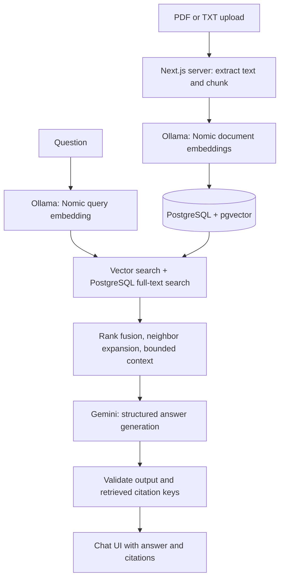
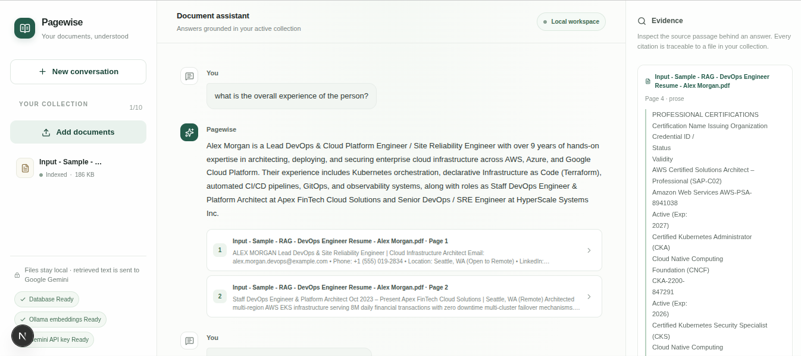
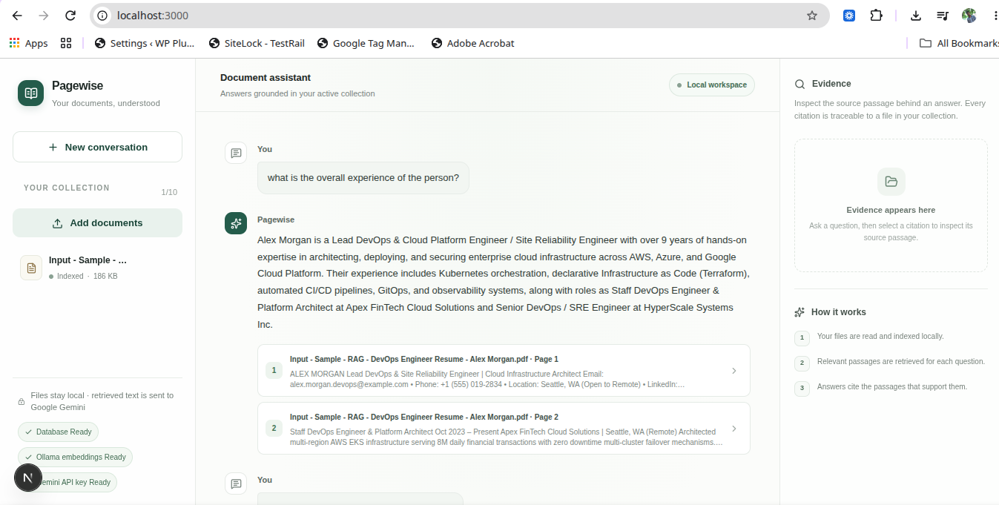

# Pagewise — Chat With Your Docs

Pagewise is a full-stack document assistant built for the “Chat With Your
Docs” assignment option. Upload PDF or TXT documents, ask questions about the
active collection, and inspect citations linking answers to retrieved
evidence.

## What works

- Upload and index PDF and plain-text documents.
- Preserve PDF page numbers and detected section headings in chunks.
- Retrieve evidence with semantic vector search and PostgreSQL full-text
  search, then return cited, structured answers or abstain when evidence is
  insufficient.
- Show uploaded files, processing status, citations, and request errors in the
  chat interface.
- Keep original files, embeddings, and retrieval in the local application;
  send only the question and selected evidence excerpts to Gemini for answer
  generation.

For the design decisions, implementation status, and clearly separated future
work, see the [technical implementation plan](./IMPLEMENTATION_PLAN.md).

## Quick start

### Requirements

- Node.js 24+
- Docker Engine with Docker Compose
- Ollama
- A Gemini API key from [Google AI Studio](https://aistudio.google.com/apikey)

### Run locally

From the project root:

```bash
cp web/.env.example web/.env
```

Set `GEMINI_API_KEY` in `web/.env`. Keep the key private; `.env` is ignored by
Git. Start PostgreSQL and Ollama:

```bash
docker compose up -d db
ollama serve
ollama pull nomic-embed-text
```

In another terminal:

```bash
cd web
npm ci
npm run db:migrate
npm run dev
```

Open [http://127.0.0.1:3000](http://127.0.0.1:3000). Set `GEMINI_MODEL` in
`web/.env` to select a different model available to your API key. The current
default is `gemini-3.6-flash`.

For detailed setup and limits, see [web/README.md](./web/README.md).

## Architecture and RAG flow



### Retrieval and generation decisions

- **Embeddings:** `nomic-embed-text` produces 768-dimensional vectors locally.
  Indexed text is prefixed with `search_document:` and questions with
  `search_query:`. The collection records an embedding-format version so
  vectors created with an older format must be reindexed instead of mixed.
- **Chunking:** PDF pages and text files are split into chunks of about 1,200
  characters with 150 characters of overlap. Page numbers, detected headings,
  and prose/code labels are retained where available.
- **Vector store:** PostgreSQL with `pgvector` stores the application records
  and vectors together. There is no separate vector database.
- **Retrieval:** Each query combines vector candidates with PostgreSQL
  full-text candidates using reciprocal-rank fusion. The current configuration
  considers up to eight candidates from each source, keeps four fused results,
  and adds adjacent chunks around selected seeds for context.
- **Context management:** Context is selected against an 8,000-character
  regular-answer budget or a 12,000-character list-answer budget. These are
  character limits, not tokenizer-measured token limits.
- **Answer model:** `gemini-3.6-flash` is called through Google's server-side
  GenAI SDK. Structured JSON output is parsed and validated; citation keys are
  constrained to retrieved evidence. Questions requiring lists receive
  exhaustive-list instructions. Local `qwen3:0.6b` generation produced
  incomplete answers, while larger local models were too slow for the available
  machine. The developer judged a model around 7B parameters or larger would be
  needed for better local accuracy and chose Gemini to avoid that local compute
  cost. Gemini 3.8 Flash access was checked, but generation was temporarily
  unavailable due to high demand during testing.
- **Orchestration:** The RAG steps are explicit application code; no agent or
  orchestration framework is used.

### Data handling and guardrails

- Original uploads and embeddings remain in local storage and PostgreSQL.
- Gemini receives the current question and selected evidence excerpts, not the
  original uploaded file or prior chat transcript. The free tier may use
  prompts to improve Google's products; do not send sensitive documents unless
  you accept the provider's [terms](https://ai.google.dev/gemini-api/docs/terms).
- The Gemini key is read only on the server from `GEMINI_API_KEY`; it is not
  exposed to browser code or logged.
- Retrieved document text is treated as untrusted input. Model output must
  match a structured schema, and citations are resolved only against evidence
  retrieved for the current question.
- Upload limits and loopback defaults are intended for a local demo. The
  application has no user authentication and must not be exposed directly to
  the public internet.

## Engineering and quality

- TypeScript for application code; Zod validation at request and response
  boundaries.
- Drizzle schema and SQL migrations; database operations are parameterized.
- Structured Pino logs record request IDs and aggregate retrieval/citation
  counts without logging document content.
- Unit tests cover chunking, retrieval ranking, context budgeting, answer
  parsing, and embedding prefixes.
- The opt-in Gemini generation test uses synthetic evidence. The opt-in local
  retrieval test checks representative queries against the local index.
- At preparation time, the complete Vitest suite, TypeScript check, and ESLint
  pass. Live provider generation was tested with synthetic content only; broad
  answer quality on private documents has not been independently benchmarked.
- Authentication, OCR, queue-based ingestion, streaming, browser end-to-end
  tests, and cloud deployment are not implemented in this assignment prototype.

Run checks from `web/`:

```bash
npm test
npm run typecheck
npm run lint
```

## Productionization path

This repository is a local demo, not a production deployment. A production
version would need, at minimum:

1. **Identity and authorization:** add sign-in, tenant-aware authorization,
   per-user document access, quotas, and auditable deletion.
2. **Secure storage:** move uploads to private object storage with encryption,
   lifecycle rules, malware scanning, backups, and scoped access. Use managed
   PostgreSQL with a supported vector extension, connection pooling, indexes,
   and tested restore procedures.
3. **Isolated processing:** move ingestion to a durable queue and worker with
   idempotency, retries, status tracking, and resource limits. Scale web and
   workers independently.
4. **Provider governance:** store Gemini credentials in a cloud secret manager,
   confirm data-processing terms and residency, monitor per-model quotas and
   spend, and offer a local or approved alternative where data policy requires
   it.
5. **Operations:** deploy containerized services behind HTTPS and a managed
   ingress; add CI/CD, migration gates, rate limits, dashboards, traces, alert
   thresholds, backup/restore drills, and a documented incident process.
6. **Quality evaluation:** maintain a consented, sanitized evaluation set;
   track retrieval recall, citation accuracy, answer faithfulness, latency, and
   cost before changing chunking, embeddings, or models.

The current synchronous local workflow, small document limits, lack of
authentication, character-based context budgets, and lack of OCR are deliberate
demo limitations rather than production claims.

## AI-assisted development

GitHub Copilot in VS Code was used for code generation, automated test work,
and maintaining a quality checklist. The developer selected the stack and RAG
pipeline, verified each pipeline stage, handled evaluation cases, and set up
the LLM. Generated changes were checked with tests, TypeScript, and linting.
The live Gemini test uses synthetic evidence rather than sending the private
uploaded document to the provider.

## Engineering standards and deliberate omissions

The implementation uses TypeScript, Zod at application boundaries, reviewed
database migrations, automated tests, linting, explicit API errors, server-side
secret handling, and structured logs that omit document contents. The prototype
deliberately defers authentication, multi-tenant authorization, OCR,
background ingestion workers, streaming answers, browser end-to-end tests, and
cloud deployment. These omissions must be addressed before using the app for
multiple users or exposing it beyond loopback.

## Recommended next iteration

The highest-value next step is a small, consented evaluation set with
human-verified expected evidence and answers. Use it to measure retrieval
recall, citation correctness, answer completeness, latency, and cost for
representative questions before tuning chunks or changing models. Then address
the deferred security and operations work required for the intended deployment.
These are technical recommendations, not claims that those evaluations or
production controls have already been completed.

## Demo video

[Watch the Pagewise demo on Loom](https://www.loom.com/share/b49dbb62d9334aeebe915a79bec51952)

## Screenshots

The demo screenshots use the supplied sample resume:




